# Visual report

| | |
|---|---|
| 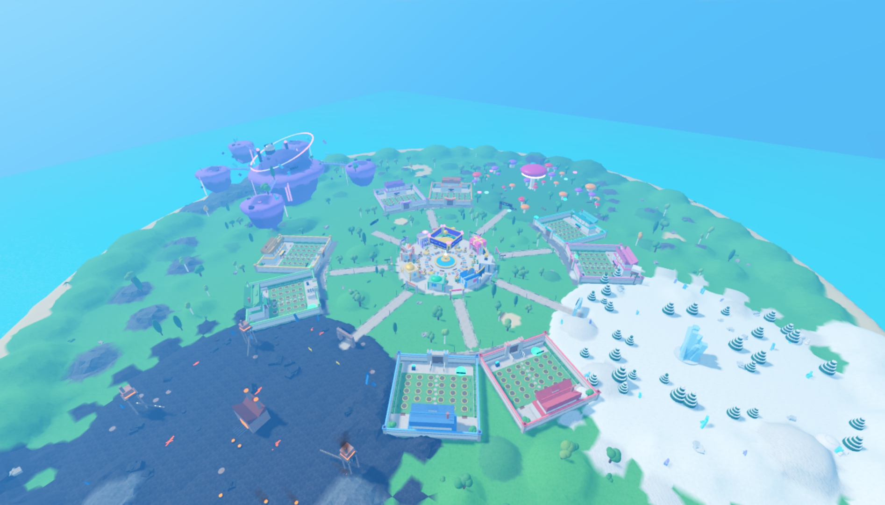 Island aerial | 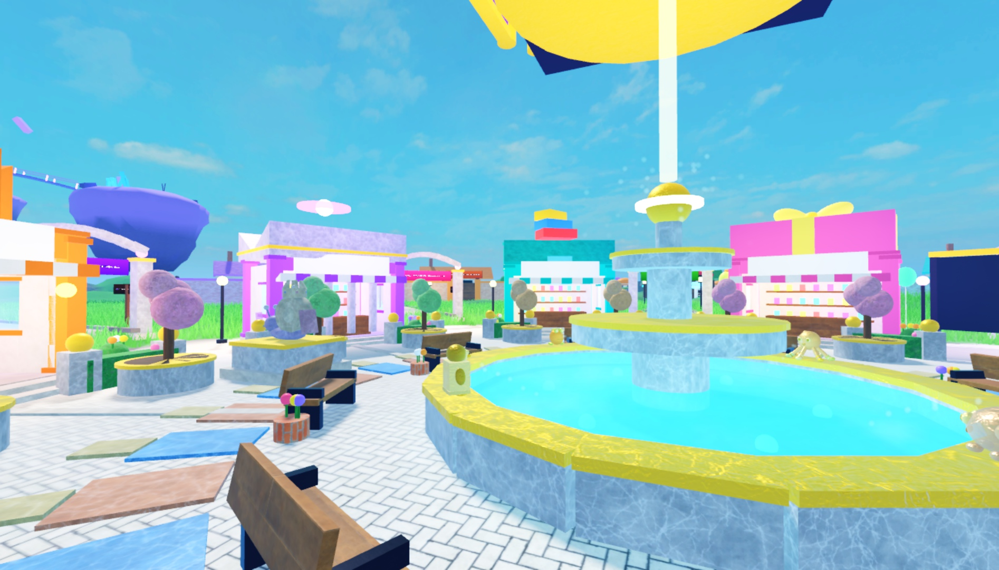 Plaza, ground level |
| 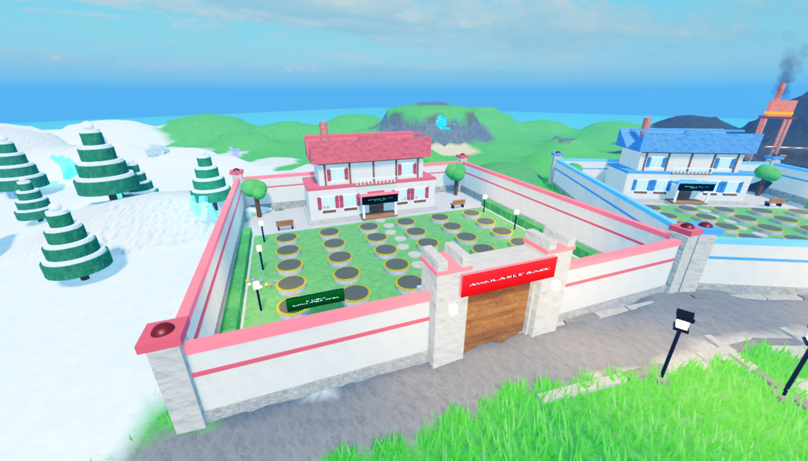 Player base | 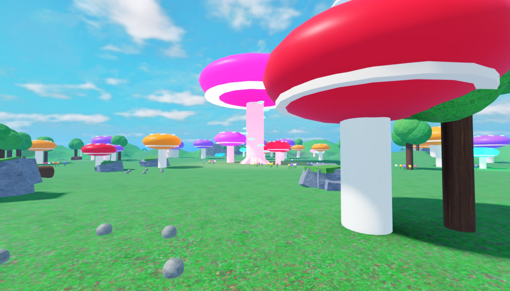 Mushroom Woods |
| 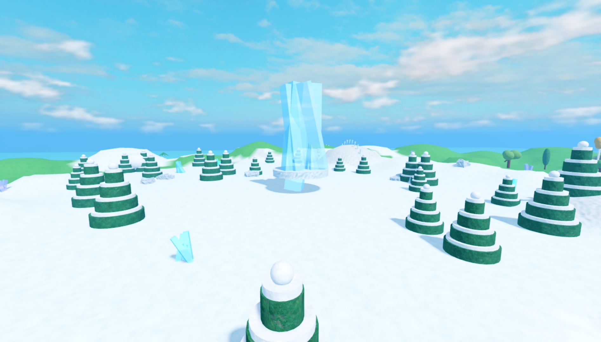 Frostbite Fields | 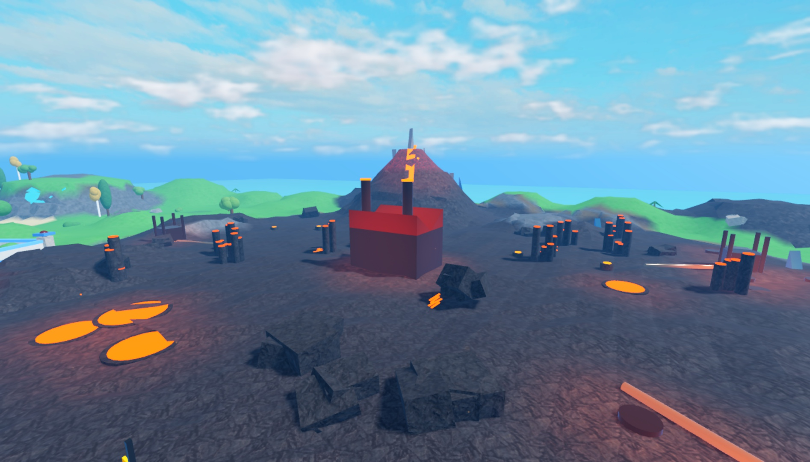 Molten Valley |
| 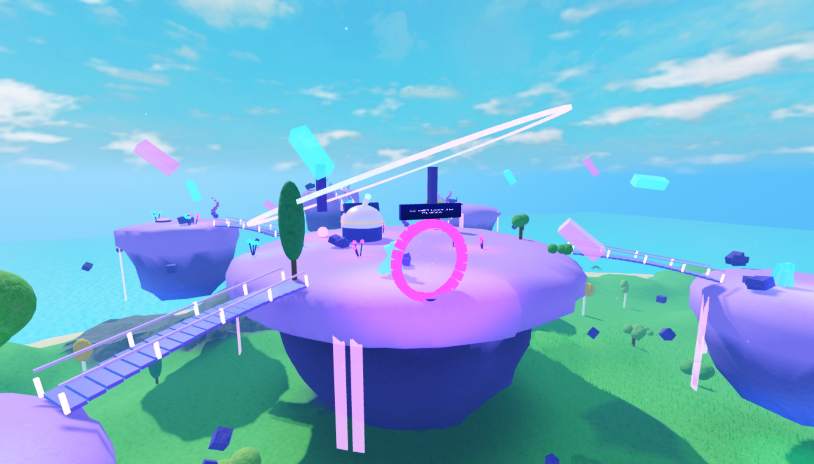 Cosmic Outlands | 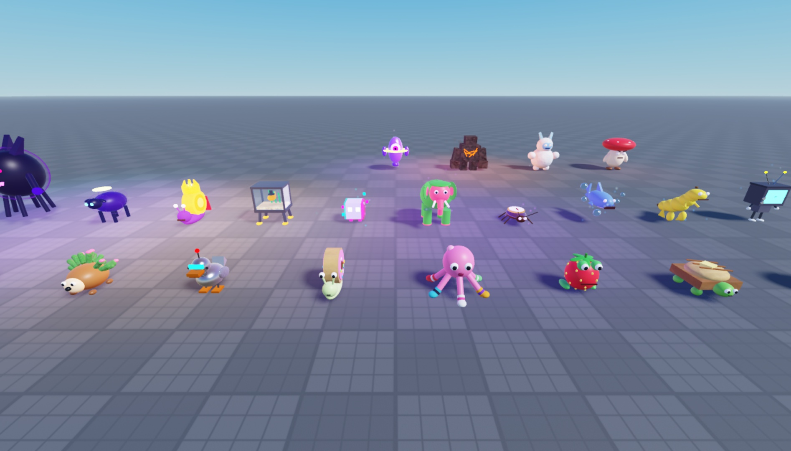 Creature roster + guardians |
| 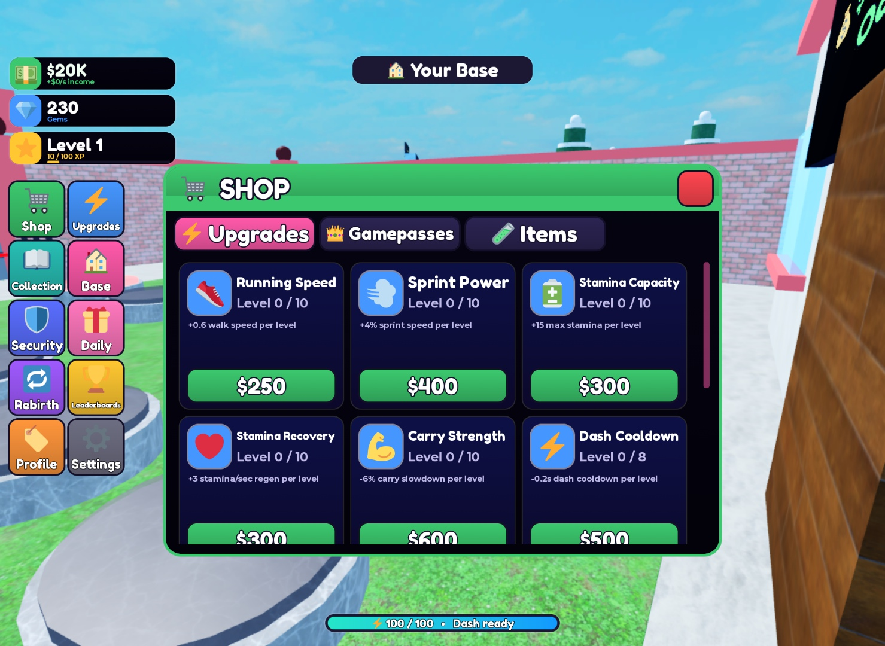 Shop UI | 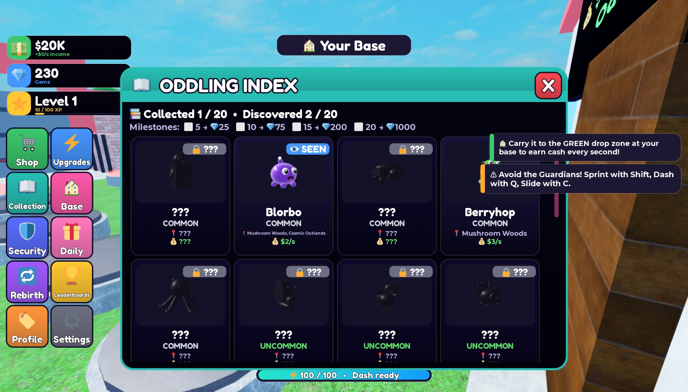 Collection index |
| 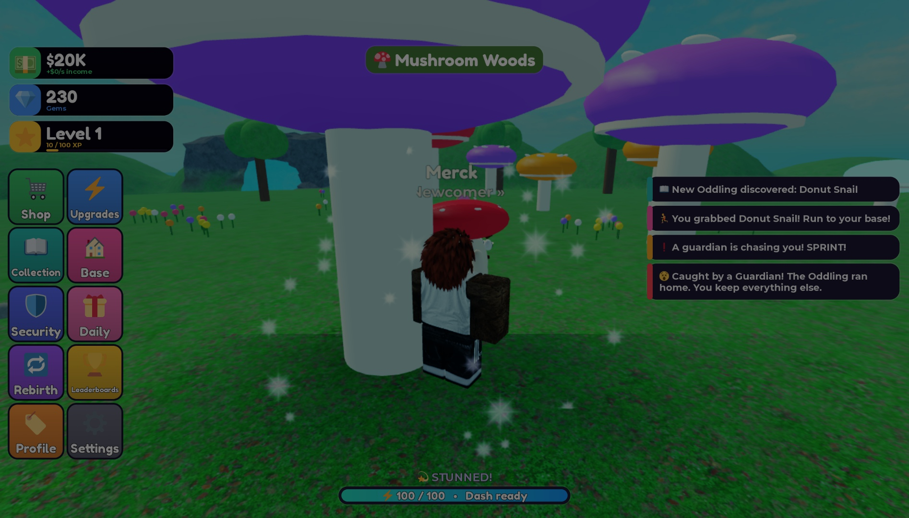 Guardian capture | 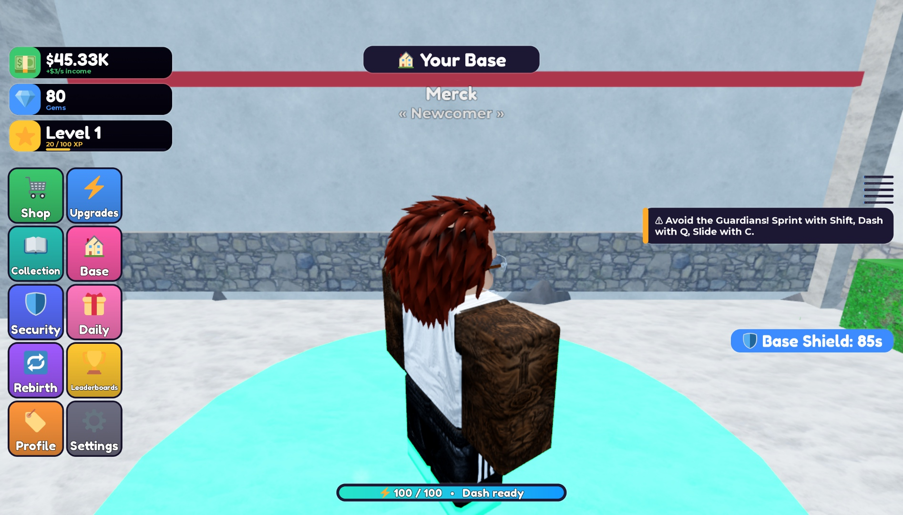 HUD with base shield |

`03_plaza_aerial_before_paving_fix.jpg` is kept as a before/after reference (plaza paving was later lowered and repaved).
UI screenshots were taken before the environment upgrade; the UI itself is unchanged.
